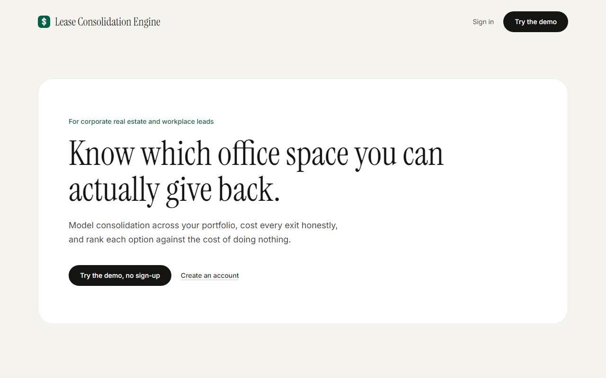
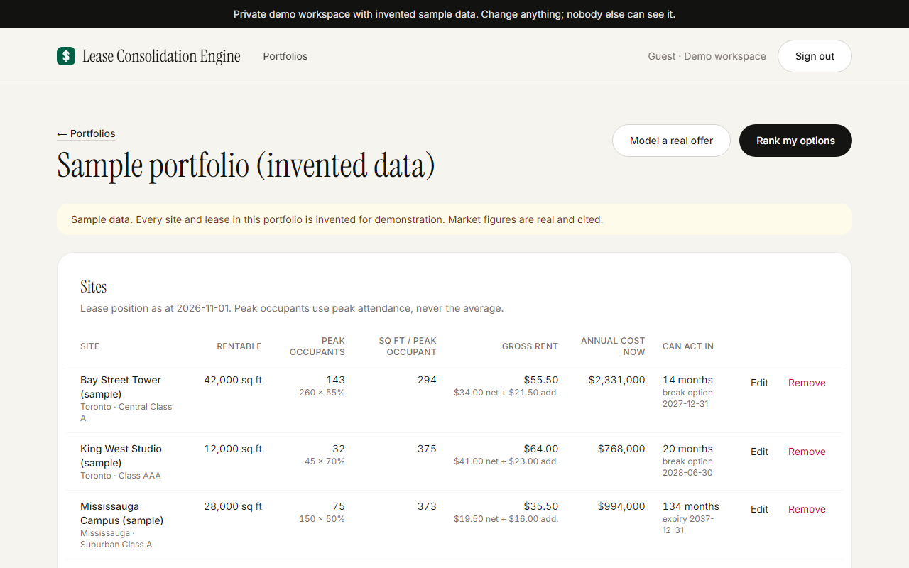
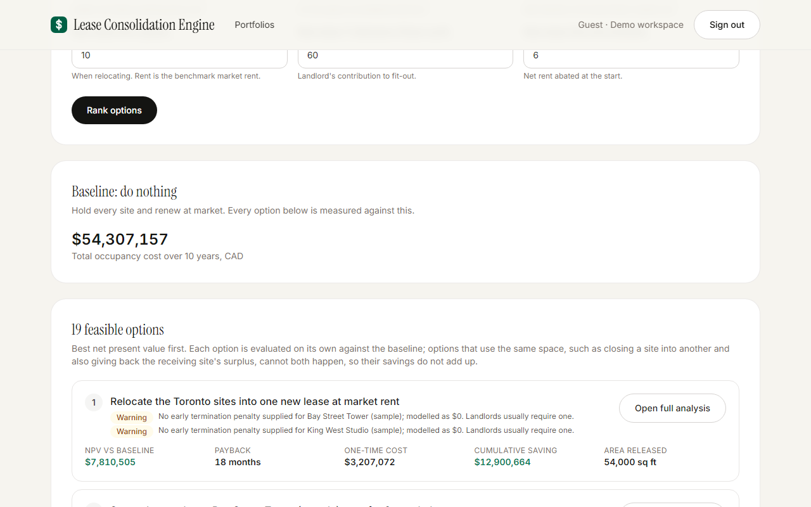
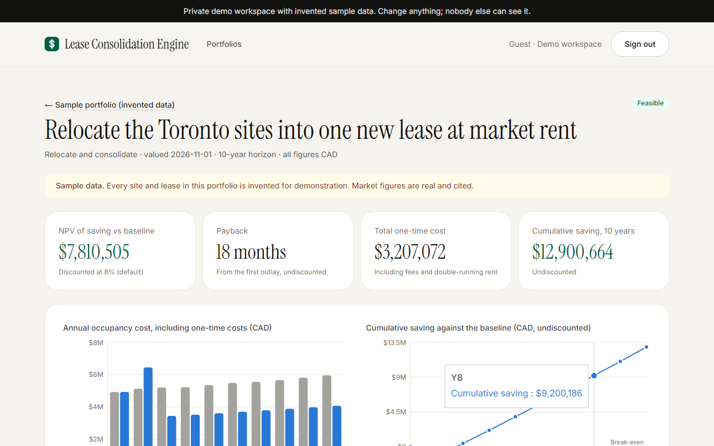

# Lease Consolidation Engine

**Know which office space you can actually give back.**

A decision tool for corporate real estate and workplace leads. It models what happens to a multi-site office portfolio under seven consolidation strategies, ranks every option against the cost of doing nothing, and says plainly when the leases don't allow an option.

### [▶ Try the live demo](https://lease-consolidation-engine.vercel.app)

One click opens a private demo workspace with an invented sample portfolio: four offices in Toronto, Mississauga and Ottawa, priced against real, cited market data. No sign-up needed.



---

## The problem

Hybrid work left companies paying for offices they don't fill. Most workplace tools stop at **"Bay Street is half empty."** That part is arithmetic.

The questions that decide whether money is actually saved are harder:

1. **Can I act on it?** Is there a lease expiry or a usable break option within reach, or is the space locked in for nine more years?
2. **What does acting cost?** Make-good, fit-out, moving, surrender premiums, double-running rent and fees.
3. **Does it pay back** before the lease would have ended anyway?

This app answers all three for every site, under every strategy.

## What it does

| | |
|---|---|
| **Sizes every site on peak attendance** | Never the average, which systematically undersizes a workplace. |
| **Checks what each lease allows** | Lease expiry, break options whose notice deadline can still be met, and mid-term mechanisms such as surrender, sublet and assignment. |
| **Costs every exit honestly** | Make-good, fit-out net of TI allowance, moving, IT, surrender premiums, double-running rent and professional fees. Warns when costs are missing rather than treating them as zero. |
| **Compares against doing nothing** | A baseline that escalates net and additional rent separately and renews each lease at market rent. Savings are never measured against today's rent. |
| **Ranks every option** | All seven strategies at every site, ranked by NPV, with payback, one-time cost and space released. |
| **Says when an option is impossible** | A full receiving site, a missed break notice deadline or no exit mechanism produces a constraints report, not a misleading number. |
| **Shows the workplace each option leaves behind** | An employee experience scorecard for every site an option changes, today and after: room on the busiest day, space to focus, confidential meetings, variety and choice, an office with a purpose, and busy versus quiet days. The targets are your own workplace brief. |

**The seven strategies:** densify in place · partial surrender at expiry · partial surrender mid-term · sublet surplus · close and absorb · blend and extend · relocate and consolidate.







## Domain traps it is built to catch

| Common mistake | What the engine does |
|---|---|
| Sizing on average attendance | Sizes on peak attendance |
| Comparing savings to today's rent | Compares to an escalating, renewing do-nothing baseline |
| Leaving out make-good and double-running rent | Costs them, and flags any scenario with no one-time costs entered |
| Taking a blend and extend's headline rent cut at face value | Reports the full committed term, including years beyond the horizon |
| Assuming a sublet will find a tenant | Models a void period and shows the no-taker case beside it |
| Assuming a break option still works | Checks whether its notice deadline has passed |
| Moving people into a site that is already full | Checks receiving capacity at the target density |
| Filling missing market data with a guess | Shows "unknown" and cites the source of every market figure |

## Data and honesty

- **Market data is real and cited.** Market rents, vacancy and sublet share come from the [Cushman & Wakefield Canada Office MarketBeat, Q3 2026](https://www.cushmanwakefield.com/en/canada/insights/canada-marketbeats/office-marketbeats), each quoted from the source. Where the source publishes no rent for a building class, the engine returns "unknown" rather than estimating one.
- **All lease data is invented.** The sample portfolio, its rents and its lease terms are made up for demonstration and labelled as sample data throughout the app.
- **Defaults are labelled.** Every result lists its assumptions, and any value that came from a default rather than the user is marked as a default.
- **All figures are CAD.**

## Engineering

**Stack:** Next.js 16 (App Router), React 19, TypeScript, Tailwind CSS 4, PostgreSQL with Drizzle ORM, Zod, Recharts, Vitest, Playwright. Hosted on Vercel with Neon Postgres.

- **The calculation engine is pure and auditable.** All the financial logic lives in [`lib/engine/`](lib/engine): no database access and no reading the clock. The valuation date is passed in, so every result can be reproduced.
- **Money uses exact decimal arithmetic.** Calculations run on 40-significant-digit decimals, never floating-point currency, and nothing is rounded until it is displayed.
- **Tests are checked by hand.** Every strategy has a worked example whose expected values were calculated by hand and written into the test as literals, not computed by the code under test. Boundary cases are covered: zero headcount, an expired lease, a missed break notice deadline, a full receiving site, and negative surplus.
- **Organizations' data is kept separate.** Every query is scoped to the caller's organization in one data-access module, and tests prove one organization can't read, edit or reference another's portfolios, sites or scenarios.
- **Authentication is built in.** It uses scrypt password hashing and server-side sessions with hashed tokens in httpOnly cookies, plus a one-click guest login that gives each visitor a private copy of the sample portfolio.
- **The same validation runs in two places.** One set of Zod schemas validates each form in the browser and again on the server.
- **End-to-end tests drive a real browser:** sign up, build a portfolio, run close-and-absorb and read the constraints report; rank options and open one; edit a site; run a scenario from the demo.

```
94 unit tests (engine, ranking, experience, data isolation, auth) · 5 end-to-end browser tests
```

## Run it locally

You need Node.js 20 or newer. No database account is required: without `DATABASE_URL`, the app uses [PGlite](https://pglite.dev), an embedded Postgres stored in `./.pglite`.

```bash
npm install
npm run dev          # migrates the local database, then serves http://localhost:3000
```

| Command | What it does |
|---|---|
| `npm run test` | Unit tests (Vitest) |
| `npm run test:e2e` | Browser tests (Playwright, against a fresh throwaway database) |
| `npm run typecheck` | TypeScript checks |
| `npm run lint` | ESLint |
| `npm run db:generate` | Generate a migration after a schema change |
| `npm run db:push` | Apply migrations and reload benchmarks |

To use a real Postgres database, set `DATABASE_URL`.

## Project structure

```
app/                 Pages and server actions (Next.js App Router)
components/          UI components, forms and charts
lib/engine/          The calculation engine: pure, decimal, fully tested
lib/data/repo.ts     All database access, scoped by organization
lib/db/              Schema, connection, benchmark data and the sample portfolio
lib/schemas/         Zod schemas shared by forms and server actions
lib/auth/            Passwords and sessions
drizzle/             SQL migrations
e2e/                 Playwright tests
```

## Limitations

This is a screening tool. Real decisions still need lease review, legal advice and actual landlord quotes; use **Model a real offer** to enter real terms.

- **Options are ranked one at a time.** The app doesn't yet search for the best combination of moves across the portfolio.
- **Market data is thin:** national figures for a single quarter.
- **Leases are entered by hand.** There is no import from Excel or lease administration systems.
- **No export, no headcount forecasting, CAD only.**
